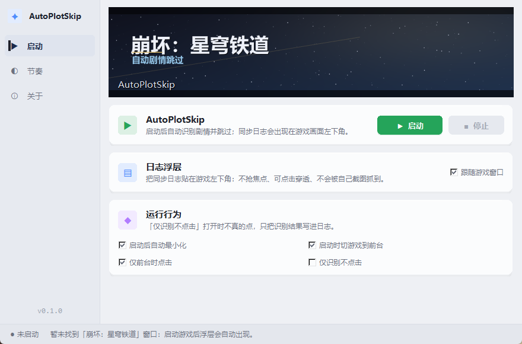
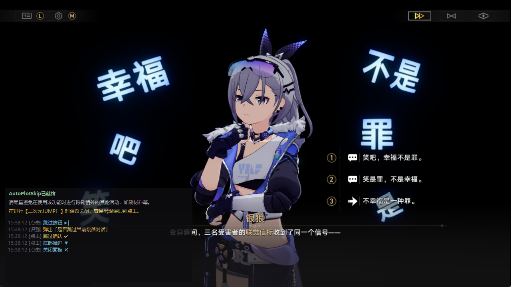

# AutoPlotSkip

崩坏：星穹铁道自动剧情跳过 | Honkai: Star Rail auto plot skip





## 功能

- **自动跳过**：识别右上角跳过按钮 ▶|，点完自动确认「是否跳过当前段落对话」。
- **推进对话**：语句大箭头 →、底部金色 ▼、手机聊天面板的推进点，循环自动点击。
- **聊天面板**：识别白底选项条、点选项、「对话结束」后点面板 ✕。
- **浮层日志**：同步日志实时贴在游戏画面左下角，不抢焦点、可点击穿透，也不会被自己的截图抓到。
- **认不出就不动**：找不到游戏窗口就干等，游戏离开前台自动暂停点击。

> **为什么不置顶游戏窗口？** 整个循环里没有任何 `SetForegroundWindow`。反复抢焦点是同类工具「游戏卡住」的根源，这里一次都不做。

> **为什么浮层不会被误识别？** 浮层自己用 `WDA_EXCLUDEFROMCAPTURE` 排除在截屏之外，截图里根本看不到它。

> **它是外挂吗？** 不是。不读写游戏内存、不修改游戏文件、不联网，只做「截图 → 识别 → 模拟鼠标点击」，和你自己手动点没有区别。

## 安装

[](../../releases)

下载 `AutoPlotSkip-v0.1.0.zip`，解压到任意目录（**整个文件夹一起解压，`_internal` 是依赖，别拆开**），双击 `启动 AutoPlotSkip.bat` 即可。

从源码运行，只需要 Python 3.10+ 和两个库：

```bat
pip install -r requirements.txt
python main.py
```

无界面模式：`python main.py --cli`；只识别不点击：`python main.py --cli --dry-run`。

## 使用

点「▶ 启动」，切回游戏进剧情。游戏若是**以管理员身份**运行的，本程序也要以管理员身份运行，否则点击会被 Windows 的 UIPI 静默丢弃 —— 右键 exe 选「以管理员身份运行」即可。

> **不要去勾**「属性 → 兼容性 → 以管理员身份运行此程序」。那个勾会写进注册表兼容层，之后每次启动都被强制提权，反而每次都弹蓝色 SmartScreen。

节奏可以在「节奏」页实时调，改完立刻生效：

- **截图间隔** `0.50s` —— 弹窗一闪而过没点到，调小。
- **空转间隔** `0.60s` —— 没有可点目标时的慢节奏，省 CPU。
- **触发间隔倍率** `x1.50` —— 同一处被连点、点乱了，调大。

## 开发

`aps/` 分四层，参考 [BetterGI](https://github.com/babalae/better-genshin-impact) 的 GameTask 思路：

```
capture.py    截图（屏幕 DC → 窗口 DC → PrintWindow 三级兜底）
vision.py     识别：模板匹配 + 结构性判断 → Scene
triggers.py   7 个触发器，按优先级调度（确认弹窗 10 → 跳过 20 → 箭头 30 → ...）
engine.py     决策与点击主循环
input.py      SendInput（纯 ctypes）
gui.py        tkinter 界面
overlay.py    左下角浮层日志
```

识别层只产出 `Scene`、决策层只读 `Scene`，所以能拿开发文档的截图做**离线回归**，不用开游戏：

```bat
python tools/diagnose.py         :: 一键体检：输入通道 / 权限 / 窗口 / 截图 / 识别
python tools/selftest.py         :: 单张截图的识别 + 决策
python tools/resolution_test.py  :: 8 种分辨率 × 10 张截图
python tools/enginetest.py       :: 整段剧情连续跑
python tools/shots_test.py       :: 真机截图回归（面板 ✕ / 跳过确认 / 面板误判）
```

回归用的截图放在 `testdata/`（`doc/` 是开发文档里的 12 张，`shots/` 是真机截的 6 张）。
全部套件当前失败 0。参数集中在 `aps/config.py`，阈值旁边都写了实测依据。

构建成 exe：

```bat
python tools/build_exe.py        :: 产物在 release/
python tools/make_extras.py      :: 生成启动 bat 与使用说明
python tools/make_package.py     :: 打成一个可分发 zip 到桌面
```

## 关于

- 感谢 [BetterGI](https://github.com/babalae/better-genshin-impact)，分层架构与触发器调度的思路来自它。
- 与米哈游 / HoYoverse 没有任何关系，未获其授权或认可。
- 使用本工具可能违反游戏用户协议，**由此产生的一切后果由使用者自行承担**。仅供学习与交流。

## License

[MIT](LICENSE)
